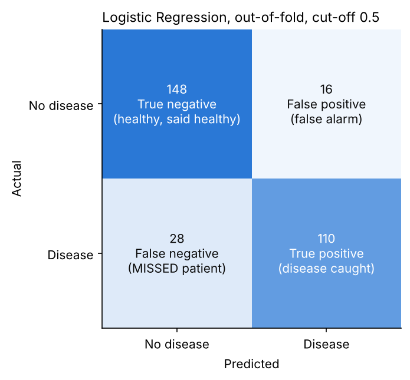
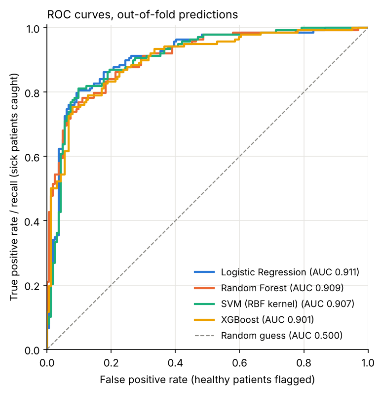
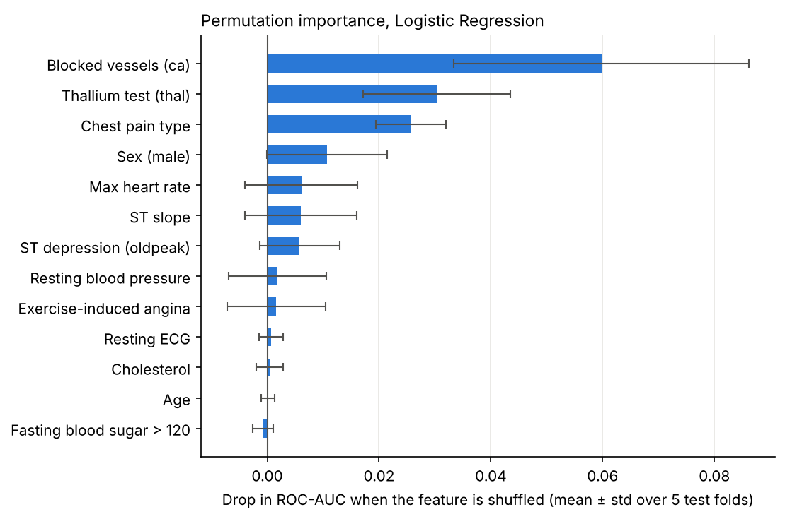

# Heart Disease Prediction

A machine learning project that predicts whether a patient has heart disease from 13 clinical measurements, with a small Flask web app.

I first built this project in 2022. When I came back to it, I found that the reported 92.2% test accuracy was not real: the dataset contained many duplicate rows, so most test patients had already been seen during training. This version fixes that and some other problems I found in the data and the app, and reports honest cross-validated results.

> **This is a student project for learning. It is not a medical tool and must not be used to diagnose or rule out heart disease.**

## Contents

- [Problem](#problem)
- [Dataset](#dataset)
- [Problems I found and how I fixed them](#problems-i-found-and-how-i-fixed-them)
- [Method](#method)
- [Results](#results)
- [Which features drive the predictions](#which-features-drive-the-predictions)
- [Limitations](#limitations)
- [Project structure](#project-structure)
- [How to run](#how-to-run)
- [References](#references)

## Problem

Given a patient's age, sex, chest pain type, blood pressure, cholesterol and results from an ECG, an exercise test and two imaging tests, predict whether coronary angiography found heart disease (more than 50% narrowing of a major artery).

This is a binary classification problem: **1 = heart disease**, **0 = no heart disease**.

## Dataset

- **Original source:** the Cleveland heart disease data from the UCI Machine Learning Repository ([UCI page](https://archive.ics.uci.edu/dataset/45/heart+disease)), collected at the Cleveland Clinic Foundation and donated in 1988. It was used in Detrano et al. (1989).
- **File used here:** `data/heart.csv`, the commonly used Kaggle copy ([Heart Disease Dataset](https://www.kaggle.com/datasets/johnsmith88/heart-disease-dataset), David Lapp). It has 1,025 rows, 13 features and a target column.

| Feature | Meaning |
|---|---|
| `age` | Age in years |
| `sex` | 1 = male, 0 = female |
| `cp` | Chest pain type: 0 = asymptomatic, 1 = atypical angina, 2 = non-anginal pain, 3 = typical angina |
| `trestbps` | Resting blood pressure (mm Hg) |
| `chol` | Serum cholesterol (mg/dl) |
| `fbs` | Fasting blood sugar > 120 mg/dl (1 = yes) |
| `restecg` | Resting ECG: 0 = left ventricular hypertrophy, 1 = normal, 2 = ST-T wave abnormality |
| `thalach` | Maximum heart rate during the exercise test |
| `exang` | Exercise-induced angina (1 = yes) |
| `oldpeak` | ST depression during exercise compared with rest (mm) |
| `slope` | Slope of the peak exercise ST segment: 0 = downsloping, 1 = flat, 2 = upsloping |
| `ca` | Number of major vessels (0–3) coloured by fluoroscopy |
| `thal` | Thallium stress test: 1 = fixed defect, 2 = normal, 3 = reversible defect |

The Kaggle file uses different number codes from the UCI documentation. I worked out the codes above by matching each Kaggle row to its row in the original UCI file (see `notebooks/01_eda.ipynb`).

## Problems I found and how I fixed them

**1. Duplicate rows caused data leakage.** Only 302 of the 1,025 rows are unique; most patients appear 3 or 4 times. In my original 80/20 split, **199 of the 205 test rows were exact copies of training rows**, so the 92.2% test accuracy mostly measured whether the model could recognise patients it had already seen.
*Fix:* drop exact duplicates before any splitting (`src/data.py`). All results below use the 302 unique patients.

**2. The labels in the Kaggle file are reversed.** Patients with `target = 1` were younger, reached a higher maximum heart rate and had fewer blocked vessels, which are signs of a healthier heart. I matched all 302 unique rows to the original UCI file: every row matched, and in every row the Kaggle label was the opposite of the UCI diagnosis.
*Fix:* flip the label so that 1 = heart disease. This matters for recall, which should be measured on the disease class.

**3. Missing values were hidden as codes.** `ca = 4` (4 patients) and `thal = 0` (2 patients) are not valid values. In the UCI file these exact cells are missing.
*Fix:* turn them back into missing values and fill them inside the model pipeline, using only the training folds.

**4. The old web app never returned real predictions.** The page sent a POST request but the Flask route only accepted GET, so every request failed with "405 Method Not Allowed" and the page showed "Good News" to everyone. The form's codes for sex, chest pain, ECG, slope and thal also did not match the data.
*Fix:* rewrote `app.py` and the form (see [How to run](#how-to-run)).

## Method

1. **Pipeline** (`src/pipeline.py`): all preprocessing is inside one scikit-learn `Pipeline`, so it is fitted only on training data during cross-validation:
   - numeric features: fill missing with the median, then standardise;
   - unordered categories (`cp`, `restecg`, `slope`, `thal`): fill missing with the most common value, then one-hot encode;
   - yes/no features: unchanged.
2. **Evaluation** (`src/evaluate.py`): stratified 5-fold cross-validation with fixed folds, so every model is tested on the same patients. I report the mean and standard deviation over the 5 test folds.
3. **Models** (`src/compare_models.py`): Logistic Regression, Random Forest, SVM (RBF kernel) and XGBoost, plus a baseline that always predicts "no disease".
4. **Tuning** (`src/tune.py`): a small grid search with `GridSearchCV`, inside **nested** cross-validation (5 outer × 5 inner folds). The outer test folds are never used for choosing settings, so the reported scores are not optimistic. Tuning optimised ROC-AUC.
5. **Final model** (`src/train_final.py`): Logistic Regression (C = 0.1) trained on all 302 patients and saved with joblib for the app.

## Results

All numbers are mean ± standard deviation over 5 cross-validation test folds, 302 unique patients.

**Tuned models (nested cross-validation):**

| Model | Accuracy | Precision | Recall | F1 | ROC-AUC |
|---|---|---|---|---|---|
| **Logistic Regression** (final) | **0.854 ± 0.019** | 0.887 ± 0.078 | **0.797 ± 0.075** | **0.833 ± 0.017** | **0.920 ± 0.019** |
| Random Forest | 0.831 ± 0.030 | 0.851 ± 0.080 | 0.783 ± 0.072 | 0.809 ± 0.028 | 0.917 ± 0.011 |
| SVM (RBF kernel) | 0.854 ± 0.033 | 0.903 ± 0.093 | 0.783 ± 0.072 | 0.831 ± 0.033 | 0.920 ± 0.017 |
| XGBoost | 0.835 ± 0.033 | 0.850 ± 0.073 | 0.790 ± 0.089 | 0.812 ± 0.041 | 0.905 ± 0.019 |
| Baseline (always "no disease") | 0.543 ± 0.007 | – | 0.000 | – | 0.500 |

Results with default settings are in `reports/cv_results_default.csv`. Tuning mainly reduced overfitting of the tree models (Random Forest and XGBoost had 100% training accuracy with default settings) and improved test scores by about 0.5–3 percentage points.

**Old vs new evaluation of the same kind of model:**

| | Data | Evaluation | Test accuracy |
|---|---|---|---|
| Original project (SVM) | 1,025 rows with duplicates | one 80/20 split | 0.922 |
| Same SVM, evaluated correctly | 302 unique patients | stratified 5-fold CV | 0.835 ± 0.019 |

The accuracy dropped by about 9 percentage points. This is expected: the old number was inflated by the leakage.

**Why I chose Logistic Regression:** it tied with the SVM for the best accuracy and ROC-AUC, and the differences between all four models are within the fold-to-fold noise (just reshuffling the folds moved the SVM's mean accuracy between 81% and 85%). Logistic Regression is the simplest, its tuned setting was stable (C = 0.1 in 4 of 5 folds), it gives probabilities directly, and its weights can be explained.

**Why recall matters here:** in medical screening, missing a sick patient (false negative) is usually worse than a false alarm (false positive), which leads to more tests. Accuracy alone can hide this: the baseline gets 54% accuracy while finding no sick patients at all. The final model finds about 80% of patients with heart disease, so it still **misses about 1 in 5**.

<p align="center">
  
  
</p>

The confusion matrix and ROC curves use out-of-fold predictions (each patient is predicted by a model that did not see them). With the standard 0.5 cut-off, 28 of 138 patients with disease were missed. Lowering the cut-off to 0.3 reduced missed patients to 12 but increased false alarms from 16 to 48 (details in `notebooks/02_results.ipynb`). Choosing a cut-off is a clinical decision, so the app keeps 0.5 and shows the probability.

## Which features drive the predictions

<p align="center">
  
</p>

I used permutation importance on the test folds: shuffle one feature and measure how much ROC-AUC drops.

- The number of blocked vessels (`ca`), the thallium test (`thal`) and the chest pain type (`cp`) clearly matter most.
- Maximum heart rate, ST depression and exercise-induced angina were strongly related to disease in the exploratory analysis but have low permutation importance. They are moderately correlated with each other (they come from the same exercise test), so when one is shuffled the model still gets similar information from the others.
- Cholesterol, age and fasting blood sugar have almost no effect on this model.

The Logistic Regression weights (`reports/figures/logreg_weights.png`) show the direction: more blocked vessels, asymptomatic chest pain, a reversible thallium defect, male sex and exercise-induced angina raise the predicted risk; a normal thallium test and a higher maximum heart rate lower it. These results describe what this model uses, not what causes heart disease.

## Limitations

1. **Small dataset.** 302 patients. Scores vary by about ±2–3 percentage points between folds, and the differences between models are within this noise.
2. **No external validation.** All results come from cross-validation on one dataset. The model has not been tested on patients from another hospital. A next step would be to test it on the other UCI heart disease datasets (Hungary, Switzerland, Long Beach VA).
3. **Old data from one clinic** (donated in 1988).
4. **Selected patients.** Everyone in the data had a coronary angiogram, so they were already suspected of heart disease. 46% have disease, far more than in the general population, so precision would be lower in a general screening setting.
5. **Few women.** Only 96 of 302 patients are women. I could not check reliably whether the model works equally well for them.
6. **The most important features need hospital tests** (fluoroscopy and a thallium stress test), so the model cannot be used with simple measurements.
7. **Cut-off and calibration.** The 0.5 cut-off was not chosen with clinicians, and I did not check whether the predicted probabilities are well calibrated.

## Project structure

```
├── app.py                  Flask app (loads the saved pipeline, validates input)
├── data/heart.csv          Kaggle copy of the UCI Cleveland data (raw, unchanged)
├── models/                 saved final pipeline (created by src/train_final.py)
├── notebooks/
│   ├── 01_eda.ipynb        data checks and exploratory analysis
│   └── 02_results.ipynb    model comparison, confusion matrix, ROC, feature importance, limitations
├── reports/                cross-validation results (CSV) and figures
├── src/
│   ├── data.py             loading and cleaning (duplicates, label flip, missing codes)
│   ├── pipeline.py         preprocessing + model pipeline
│   ├── evaluate.py         stratified 5-fold cross-validation
│   ├── compare_models.py   four models with default settings
│   ├── tune.py             nested cross-validation with GridSearchCV
│   └── train_final.py      trains and saves the final model
├── templates/, static/     web page
├── tests/test_app.py       tests for the Flask app
└── requirements.txt
```

## How to run

Tested with Python 3.14 on macOS.

```bash
git clone https://github.com/mrym1/Heart_Disease_Prediction_Flask.git
cd Heart_Disease_Prediction_Flask
python3 -m venv .venv
source .venv/bin/activate          # Windows: .venv\Scripts\activate
pip install -r requirements.txt
```

On macOS, XGBoost also needs OpenMP: `brew install libomp`.

Reproduce the results (run from the project folder):

```bash
python -m src.data             # cleaning summary: 302 patients, class balance
python -m src.compare_models   # four models, default settings
python -m src.tune             # nested CV with tuning (about 1 minute)
python -m src.train_final      # train and save the final model
```

Then open the notebooks in `notebooks/` to see the analysis and plots.

Run the tests and the web app:

```bash
python -m pytest               # 6 tests
python app.py                  # open http://127.0.0.1:8000
```

The `/reply` endpoint accepts a JSON POST with the keys `Age, Sex, Cp, Bp, Chol, Fbs, Restecg, Thalach, Exang, Oldpeak, Slope, Ca, Thal` (same codes as the table above) and returns, for example, `{"prediction": 1, "probability": 0.97}`. Invalid input returns status 400 with a list of errors.

## References

- Detrano, R., Janosi, A., Steinbrunn, W., Pfisterer, M., Schmid, J., Sandhu, S., Guppy, K., Lee, S., & Froelicher, V. (1989). International application of a new probability algorithm for the diagnosis of coronary artery disease. *American Journal of Cardiology*, 64, 304–310.
- Janosi, A., Steinbrunn, W., Pfisterer, M., & Detrano, R. (1988). Heart Disease [Dataset]. UCI Machine Learning Repository. https://archive.ics.uci.edu/dataset/45/heart+disease
- Burleigh, T. (2020). Blog post on errors in the Kaggle version of this dataset. https://tylerburleigh.com/blog/2020/03/20
